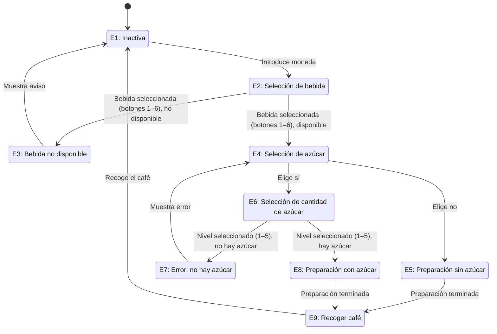

Máquina de café

Descripción del funcionamiento de una máquina de café mediante un diagrama de estados.

## Estados

| Estado | Descripción |
| --- | --- |
| E1 | Inactiva: espera a que se introduzca una moneda. |
| E2 | Selección de bebida: permite elegir una bebida con los botones del 1 al 6. |
| E3 | Bebida no disponible: informa al usuario y vuelve a E1. |
| E4 | Selección de azúcar: permite elegir entre sí o no. |
| E5 | Preparación de café sin azúcar. |
| E6 | Selección de cantidad de azúcar: permite elegir un nivel del 1 al 5. |
| E7 | Azúcar no disponible: muestra un error y vuelve a E4. |
| E8 | Preparación de café con azúcar. |
| E9 | Recogida del café: espera a que el usuario recoja la bebida y vuelve a E1. |

## Transiciones entre estados

| Transición | Condición |
| --- | --- |
| E1 → E2 | Se introduce una moneda. |
| E2 → E3 | Se selecciona una bebida (botones 1–6) y no está disponible. |
| E3 → E1 | Se muestra el aviso de que no hay bebida. |
| E2 → E4 | Se selecciona una bebida (botones 1–6) y está disponible. |
| E4 → E5 | Se elige preparar el café sin azúcar. |
| E5 → E9 | Termina la preparación sin azúcar. |
| E4 → E6 | Se elige preparar el café con azúcar. |
| E6 → E7 | Se selecciona un nivel de azúcar (1–5), pero no hay azúcar disponible. |
| E7 → E4 | Se muestra el error y se vuelve a elegir si se desea azúcar. |
| E6 → E8 | Se selecciona un nivel de azúcar (1–5) y hay azúcar disponible. |
| E8 → E9 | Termina la preparación con azúcar. |
| E9 → E1 | Se recoge el café. |

## Diagrama de estados

